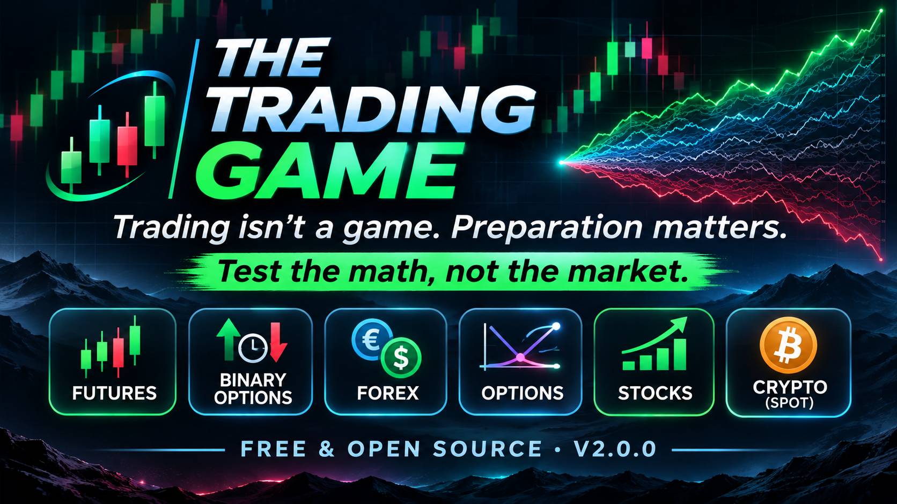

# 📈 The Trading Game

**Trading isn’t a game. Preparation matters.**

What if you could explore thousands of possible trading outcomes before risking real money?

The Trading Game is a **free, open-source Monte Carlo strategy tester** designed to help traders understand mathematical expectancy, position sizing, trading costs and risk.



[](https://michaelsboost.com/TheTradingGame/)
[](https://github.com/michaelsboost/TheTradingGame)
[](LICENSE.md)
[](https://github.com/michaelsboost/TheTradingGame/stargazers)
[](https://github.com/michaelsboost/TheTradingGame/issues)

**[🚀 Test your strategy](https://michaelsboost.com/TheTradingGame/) · [💻 View source](https://github.com/michaelsboost/TheTradingGame) · [💚 Donate](https://michaelsboost.com/donate)**

---

## ✨ What can you do?

- 🎯 **Customize** your win rate, starting capital, risk, exits and trading expenses.
- 🧮 **Calculate** break-even win rates and mathematical expectancy after modeled costs.
- 📊 **Simulate** up to 5,000 possible outcomes with up to 10,000 trades per outcome.
- 📉 **Explore** account growth, drawdowns, losing streaks and account failure risk.
- ⚖️ **Compare** half, normal and double risk using the same simulated trade outcomes.
- 🔄 **Restore defaults** for the selected market to explore a small positive mathematical expectancy under example assumptions.
- 📱 **Use** the responsive Midnight interface on desktop or mobile, with locally saved settings.

## 🌐 Supported markets

| Market | Model |
| --- | --- |
| Futures | Contracts, tick values, margin, fees, slippage and fixed or trailing exits |
| Binary options | Fixed payouts and minimum stakes |
| Forex | Currency pairs, position sizing, unit values and modeled costs |
| Options | Long calls and puts using assumed premium movements |
| Stocks | Shares and ETFs with configurable position sizes and costs |
| Crypto | Spot assets with configurable position sizes and costs |

## 🧠 The philosophy behind The Trading Game

> Test the math, not the market.

A strategy needs a statistical edge. Money management alone cannot create one. This tool helps you explore how an assumed edge behaves over many possible sequences of wins and losses, including the impact of trading costs and losing streaks.

Before trading, study market structure, price action, indicators, chart patterns, volume, liquidity, momentum, volatility, news, execution and trading psychology. Backtest your rules and forward test them in a demo account.

## ⚠️ Know before you trade

This is an educational simulator, not financial advice, a signal service or a market backtester. It uses assumptions you supply, not live market prices. Default settings illustrate mathematical expectancy; they do not establish a real trading edge or guarantee profitability. Costs and capital requirements are illustrative and should be adjusted to your broker. Options do not use a full derivatives pricing model, and real losses can exceed modeled stops or deposits in leveraged markets.

## 🛠️ Run it yourself

Download or clone the repository and open the standalone HTML application in a modern browser. No build step or external JavaScript libraries are required for the standalone version.

```bash
git clone https://github.com/michaelsboost/TheTradingGame.git
cd TheTradingGame
```

## 🤝 Contribute

Feedback, corrections and contributions are welcome, especially improvements to the mathematical models, accessibility and educational resources.

**[🐛 Report an issue](https://github.com/michaelsboost/TheTradingGame/issues) · [⭐ Star the repo](https://github.com/michaelsboost/TheTradingGame/stargazers)**

## 📄 License

[MIT License](LICENSE.md).

## 👋 Creator

Created by **Michael Schwartz** · [michaelsboost.com](https://michaelsboost.com)

[More finance projects](https://michaelsboost.com/finance)

---

**📈 The Trading Game — Test the math, not the market.**
